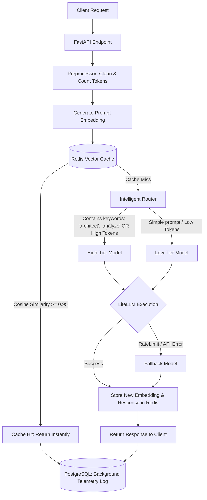

# System Architecture: Cost-Optimized LLM Gateway

## 1. Data Flow Diagram

The following Mermaid diagram maps the exact lifecycle of a single request passing through the gateway.

## 2. Intelligent Routing Heuristics

The routing engine is designed to balance financial cost with required intelligence.

Keyword Routing: Prompts containing specific keywords (e.g., "architect", "analyze", "system") inherently require deep, multi-step reasoning. The router intercepts these and forces them to the High-Tier model (e.g., Gemini Flash or GPT-4).

Token-Based Routing: Even if a prompt lacks complex keywords, a massive context window (e.g., > 1000 tokens) requires a model with strong attention mechanisms. These are also routed to High-Tier.

Default to Low-Tier: All other requests (e.g., "What is the capital of France?") are routed to lightning-fast, ultra-cheap open-source models (e.g., Groq / Qwen), saving up to 90% in API costs for simple queries.

## 3. Semantic Vector Caching Strategy

Traditional caching requires an exact string match (e.g., "How do I boil an egg?" misses if the user types "How to boil an egg?"). Our gateway uses Semantic Vector Caching to solve this.

Embedding Generation: Every incoming prompt is converted into a high-dimensional mathematical array (a vector embedding) that represents the meaning of the sentence, not just the words.

Cosine Similarity: Redis performs a highly optimized mathematical comparison (Cosine Similarity) between the new prompt's vector and all previously stored vectors.

Thresholding: If the cosine similarity score is >= 0.95, the mathematical distance between the two concepts is incredibly small. The gateway considers this a "Semantic Match" and serves the cached answer, entirely bypassing the LLM API and saving 100% of the inference cost.
