# High-Performance, Cost-Optimized LLM Gateway

A production-grade LLM Gateway engineered with **FastAPI**, **Redis Vector Search**, **PostgreSQL (asyncpg)**, and **LiteLLM**. Designed to drastically slash LLM API inference costs and latency while providing automated fallbacks, semantic caching, and full FinOps telemetry.

---

## 🌟 Key Highlights & Architectural Features

- **Semantic Vector Caching (Redis):** Converts prompts into vector embeddings and computes cosine similarity ($\ge 0.95$) to serve repetitive and semantically equivalent queries in under **10ms** at **$0.00 cost**.
- **Dynamic Heuristic Routing:** Automatically routes lightweight, high-frequency queries to fast, cost-effective models (e.g., Groq / Qwen) while reserving high-tier reasoning engines (e.g., Gemini Flash / Pro) for long-context or analytical prompts.
- **Automated Fault Tolerance & Fallbacks:** Intercepts API rate limits (`429`) and provider outages via LiteLLM fallbacks, ensuring zero user-facing service interruptions.
- **Non-Blocking FinOps Telemetry:** Offloads database persistence (token count, latency, USD cost, cache status) to `fastapi.BackgroundTasks` using an asynchronous PostgreSQL connection pool (`asyncpg`), guaranteeing zero latency overhead for the client.
- **Comprehensive Test Coverage:** Fully automated unit tests and integration tests mocking network outages and verifying end-to-end semantic cache hits.

---

## 🏗️ System Architecture

```mermaid
flowchart LR
    Client([Client Request]) --> API[FastAPI Gateway]

    API --> Pre[Preprocessor & Token Counter]
    Pre --> Embed[Embedding Generator]
    Embed --> Redis[(Redis Vector Cache)]

    Redis -- "Hit (Cosine >= 0.95)" --> CachedResp["Cached result<br/>$0.00 / 10ms"]
    Redis -- "Miss" --> Router[Intelligent Router]

    Router -- "Keyword / >1k Tokens" --> HighTier[High-Tier Model]
    Router -- "Default / Low Token" --> LowTier[Low-Tier Model]

    HighTier & LowTier --> LiteLLM[LiteLLM Provider Layer]
    LiteLLM -- "RateLimit / Outage" --> Fallback[Automated Fallback Model]

    LiteLLM & Fallback --> StoreCache[(Update Redis Cache)]
    StoreCache --> UserResp[Return Fresh Response]

    CachedResp & UserResp -.-> BGTask[FastAPI BackgroundTasks]
    BGTask -.-> PG["PostgreSQL<br/>async pool"]
```



## 🛠️ Tech Stack & Dependencies

| Category                   | Technology                                              |
| -------------------------- | ------------------------------------------------------- |
| Language & Framework       | Python 3.11+, FastAPI, Uvicorn                          |
| Data Validation & Settings | Pydantic v2, Pydantic-Settings                          |
| Vector Database & Cache    | Redis Stack (redis-om / raw vector search)              |
| Relational Database & ORM  | PostgreSQL 16, SQLAlchemy 2.0 (Mapped Columns), asyncpg |
| LLM Orchestration          | LiteLLM                                                 |
| Testing Suite              | pytest, pytest-asyncio, httpx, unittest.mock            |
| Infrastructure             | Docker, Docker Compose                                  |

## 🚀 Quickstart & Setup Guide

### 1. Prerequisites

Ensure you have the following installed:

- Docker & Docker Compose
- API keys for your preferred LLM providers (e.g., Groq, Google Gemini)

### 2. Clone the Repository & Configure Environment

```bash
git clone https://github.com/Satyanagapraveen/Cost-Optimized-LLM-Gateway
cd cost-optimized-llm-gateway
cp .env.example .env
```

Edit `.env` with your credentials:

```bash
# Database Credentials
POSTGRES_USER=Cost_LLM_USER
POSTGRES_PASSWORD=your_secure_password
POSTGRES_DB=Cost_Optimized_LLM_DB
DATABASE_URL=postgresql+asyncpg://Cost_LLM_USER:your_secure_password@db:5432/Cost_Optimized_LLM_DB

# Cache Configuration
REDIS_URL=redis://redis:6379

# Model Providers
GROQ_API_KEY=gsk_your_groq_api_key
GEMINI_API_KEY=your_gemini_api_key
```

### 3. Spin Up the Infrastructure

Build and launch all microservices (FastAPI API, PostgreSQL, Redis):

```bash
docker compose up -d --build
```

Verify that all 3 containers are healthy:

```bash
docker compose ps
```

## 🧪 Running the Automated Test Suite

Run unit and integration tests inside the running container:

```bash
# Run all tests (Preprocessing, Routing, Caching, and Fallbacks)
docker compose exec api pytest tests/ -v

# Run individual test suites
docker compose exec api pytest tests/test_preprocessing.py -v
docker compose exec api pytest tests/test_router.py -v
docker compose exec api pytest tests/test_integration.py -v -s
docker compose exec api pytest tests/test_fallback.py -v -s
```

## 📡 API Reference & curl Examples

### 1. Chat Completion Endpoint

Routes the prompt, checks the cache, invokes the model, and schedules telemetry logging.

**Request:**

```bash
curl -X POST http://localhost:8000/v1/chat/completions \
  -H "Content-Type: application/json" \
  -d '{
    "prompt": "What is the capital of France?",
    "user_id": "eng_tester_01",
    "max_tokens": 100
  }'
```

**Response (Cache Miss - First Request):**

```json
{
  "response": "The capital of France is Paris.",
  "model_used": "groq/qwen/qwen3.8-27b",
  "cost_usd": 0.0,
  "cache_hit": false
}
```

**Response (Cache Hit - Second Request):**

```json
{
  "response": "The capital of France is Paris.",
  "model_used": "groq/qwen/qwen3.8-27b",
  "cost_usd": 0.0,
  "cache_hit": true
}
```

### 2. FinOps Analytics Summary

Aggregates gateway usage, total spend, average latency, and cache hit ratio directly within PostgreSQL using SQL aggregate functions (`func.sum`, `func.count`, `func.avg`).

**Request:**

```bash
curl -s http://localhost:8000/v1/analytics/summary
```

**Response:**

```json
{
  "total_requests": 50,
  "total_cost_usd": 0.018672,
  "average_latency_ms": 8184.94,
  "cache_hit_rate_percent": 64.0
}
```

### 3. Request Audit by ID

Inspect the telemetry record of any specific invocation using its unique UUID.

**Request:**

```bash
curl -s http://localhost:8000/v1/analytics/requests/6d94912d-30f9-46cf-b2d5-3f995db3ac9d
```

**Response:**

```json
{
  "id": "6d94912d-30f9-46cf-b2d5-3f995db3ac9d",
  "timestamp": "2026-10-14T09:00:29.491995+00:00",
  "user_id": "eng_tester_01",
  "model_used": "groq/qwen/qwen3.8-27b",
  "prompt_tokens": 17,
  "completion_tokens": 500,
  "total_tokens": 517,
  "cost_usd": 0.0,
  "latency_ms": 471.55,
  "is_cache_hit": false
}
```

## 📈 Cost Simulation Benchmark

To simulate real-world traffic with repetitive, analytical, and low-latency prompts:

```bash
docker compose exec api python scripts/simulate_traffic.py
```

**Real Benchmark Results (50 Requests):**

- Baseline Cost (Direct High-Tier without Cache): ~$0.2000
- Gateway Actual Spend: $0.018672
- Net Cost Reduction: ~90.6%
- Cache Hit Rate: 64%

For deep architectural breakdowns and trade-off analyses, refer to `Architecture.md` and `COST_ANALYSIS.md`.
